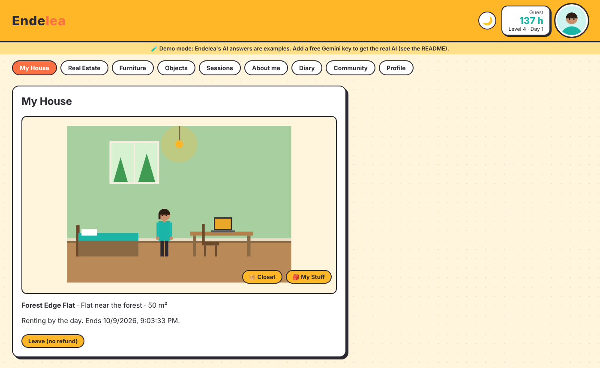
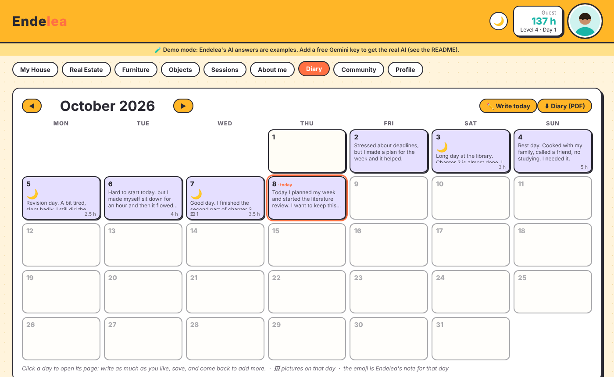
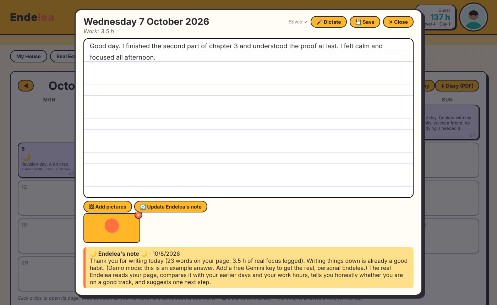
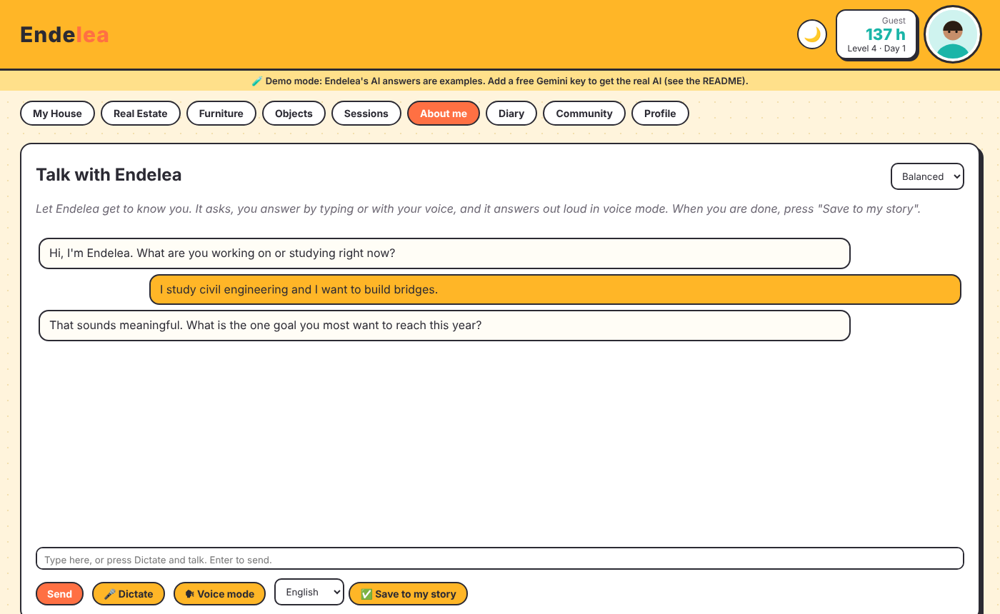
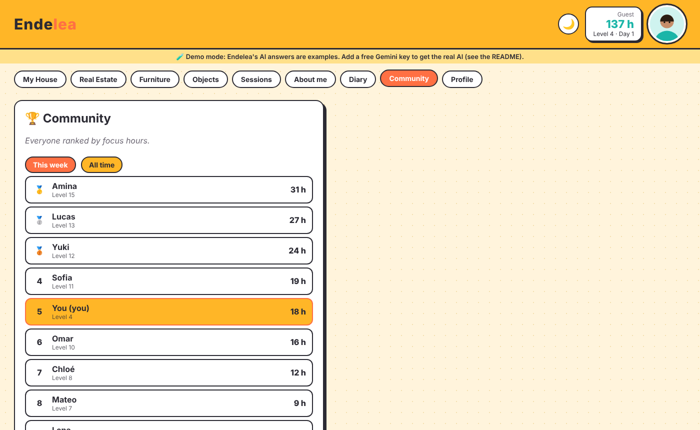

# Endelea

**Focus hours become a home.** You work, the app counts your real focus time, and you spend those hours on a virtual home, furniture and objects. Around it sits a private diary with an AI companion that notices how you are doing.

> ▶ **Demo video:** `ADD_YOUR_VIDEO_LINK_HERE`



## Try it in 2 minutes (no account, no key)

You need [Python 3.10+](https://www.python.org/downloads/). Then:

```bash
git clone https://github.com/YOUR_NAME/endelea.git
cd endelea
pip install -r requirements.txt
python -m uvicorn backend.main:app --port 8000
```

Open <http://127.0.0.1:8000>.

On **Windows** you can also double-click `start.bat`; on Mac/Linux run `./start.sh`.

Without a Gemini key the app runs in **demo mode**: everything works, but the AI answers are ready-made examples (a yellow banner says so). Nothing is sent to the internet.

### Turn on the real AI (free)

1. Get a free key at <https://aistudio.google.com/apikey>.
2. Set it before starting the server (never put it in the code):

   | System | Command |
   |---|---|
   | Windows PowerShell | `$env:GEMINI_API_KEY="your-key"` |
   | Mac / Linux | `export GEMINI_API_KEY="your-key"` |

3. Start the server again. The demo banner disappears.

`ENDELEA_DEMO=1` forces demo mode even if a key is set. `ENDELEA_MODEL` picks another Gemini model (for example `gemini-flash-lite-latest` for faster answers). `ENDELEA_DB` changes where the database file is stored.

## What it does

| Area | What you can do |
|---|---|
| **Sessions** | Start a focus session on a task; stopping it adds the hours (max 12 h per session). Workout hours are capped at 1 h per day. |
| **Real Estate** | Rent a home by the day or month, or buy it, with hours. 18 homes in 6 categories. Rentals expire, with a renew popup. |
| **Furniture / Objects** | Buy or rent items; place furniture in your room (big furniture needs a big home). |
| **Diary** | A full-screen month calendar. Click a day to open a paper page: write as much as you like, dictate with your microphone, drag in pictures, and export the whole diary as a PDF. |
| **Endelea's note** | One button writes a yellow note about your day, your work and your mood, comparing it with your earlier days and real work hours. It also appears in the PDF. |
| **About me** | Talk with Endelea (typing or voice) and she turns it into notes about you. |
| **Profile** | A short positive "My story" text, new every day, and your active rentals. |
| **Community** | A leaderboard by focus hours (this week / all time). **In this prototype the other people are invented examples**, see below. |

| Diary calendar | A day's page, with picture and note |
|---|---|
|  |  |

| About me (AI conversation) | Community leaderboard |
|---|---|
|  |  |

## Optional: sample week (for screenshots or a demo video)

`python seed_sample_week.py` fills an empty app with one **sample** week: 7 focus sessions (23.5 h), 7 diary pages and a short About me text, so the AI has something to talk about. It refuses to run if you already have data. The content is invented sample data; say so if you present it.

## How the AI is used (and what is sent)

AI features call Google Gemini from **your own server**, using **your own key**. The text involved in a request is sent to Google when you use that feature: the About me chat, "Save to my story", the daily story, and the "Endelea's note" button (your page for that day and your recent days). Pages are **not** sent in the background. On the free Gemini tier Google may use submitted content to improve its products, so check Google's current terms before writing very private things. Your diary and pictures are stored locally in `endelea.db`.

## Honest status

This is a **working prototype**, not a finished product.

- **Single user, no accounts.** It runs on your own computer. There is no login. Do not expose it on the internet with private data in it.
- **The community is a demo.** A real one needs accounts, a shared server and protection against fake hours. That is the next step.
- **No AI work check yet.** Hours come from the session timer. Having the AI verify that the stated task was really worked on is planned, not built.
- AI answers were tested against a simulated Gemini; real answers and speed depend on Google's free tier, which is sometimes busy. The app retries and falls back to other Gemini models automatically.

## Project layout

```
seed_sample_week.py   optional sample week for demos
backend/main.py    FastAPI + SQLite: sessions, homes, shop, rentals
backend/diary.py   Diary, pictures, PDF, About me, Endelea's note, demo mode, community
webapp/            index.html (app shell) + diary.js (About me, Diary, Profile, Community)
docs/              screenshots
```

## Optional: hosting it

Any host that runs Python can run `uvicorn backend.main:app --host 0.0.0.0 --port $PORT`. If you host a public demo, set `ENDELEA_DEMO=1` and treat it as a **shared** demo: everyone sees the same data and free hosts often reset the database. (Not tested here.)

## License

MIT, see `LICENSE`.
